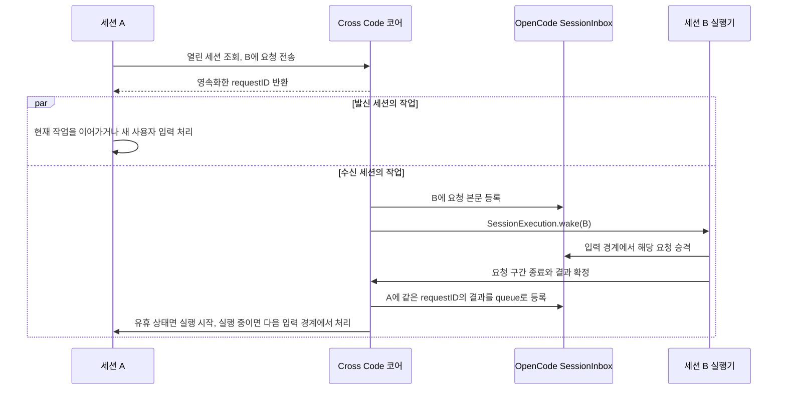

# Cross Code 세션 간 메시징 설계

상태는 설계 제안이다. 이 문서의 구현 기준은 OpenCode `bab0d0413ff31edd07b55fc499294e2e031c57d2`이며, Mesh 분석 기준은 `@log0u7/opencode-mesh` 0.10.8의 `6aa6635d8d4e5427e8508ab3587fcd101ba85a88`이다. [OpenCode 기준 커밋](https://github.com/anomalyco/opencode/commit/bab0d0413ff31edd07b55fc499294e2e031c57d2) · [Mesh 기준 커밋](https://github.com/log0u7/opencode-mesh/commit/6aa6635d8d4e5427e8508ab3587fcd101ba85a88)

작업 단위, DB와 API 변경 지점, 수용 테스트는 별도 구현 계획에 적었다. [구현 계획](cross-session-messaging-implementation.md)

## 목표와 첫 릴리스 범위

이미 열린 세션 A의 에이전트가 세션 B를 조회하고 텍스트 요청을 보낸다. B가 유휴 상태면 메시지 본문으로 턴을 시작한다. 실행 중이면 다음 입력 경계에 요청을 처리한다. B의 결과는 같은 요청 ID로 A에 돌아오며, 열린 A가 자동으로 결과를 이어받는다. 사람이 터미널 사이에서 메시지를 복사하거나 B에 별도 초기 프롬프트를 입력할 필요가 없다.

전송은 비동기다. 접수 기록이 저장되면 전송 도구가 반환하고 A는 현재 턴의 도구 실행과 응답 생성을 이어갈 수 있다. B의 처리 중에도 A는 다른 세션에 요청을 보내거나 새 사용자 프롬프트를 처리할 수 있다. A의 현재 작업이 먼저 끝나면 평소처럼 유휴 상태로 돌아가며, B의 응답은 도착할 때 독립적으로 전달된다.

첫 릴리스는 같은 OS 사용자와 Cross Code 로컬 관리형 서버를 공유하는 TUI에서 일대일로 동작한다. 같은 프로젝트의 여러 디렉터리와 worktree를 다루며, 다른 프로젝트는 양쪽 세션이 명시적으로 참여한 공유 채널이 있을 때 주소 지정할 수 있게 후속 단계에서 확장한다. 별도 서버 프로세스와 원격 호스트 연동은 이 릴리스 이후의 범위다. 세션 자동 생성, 팀 작업표, 브로드캐스트, 파일 첨부, Mesh 호환 전송은 별도 기능으로 다룬다.

Claude Code의 비교 대상으로는 이미 열린 대화에서 `ListAgents`와 `SendMessage`를 사용하는 cross-session messaging을 삼았다. Claude는 유휴 수신 세션을 깨우고 실행 중인 수신 세션에는 도구 호출 사이에 입력을 전달한다. 에이전트의 명시적 답장과 선택적 idle 통지가 문서화되어 있다. Cross Code의 기본은 현재 작업을 보호하는 `queue`와 요청별 자동 결과 반환이다. [Claude Code 공식 문서](https://code.claude.com/docs/en/cross-session-messaging)

## 코드 분석

| 주제 | OpenCode에서 확인한 동작 | Mesh에서 확인한 동작과 설계에 반영할 점 |
| --- | --- | --- |
| 검색과 주소 | `Session.list`는 저장된 대화 목록이다. `session.active`는 이 프로세스가 실행 중인 세션 집합을 돌려주며 열린 유휴 세션을 포함하지 않는다. `LocationActivity`는 로딩된 디렉터리 서비스의 퇴거 정책을 관리한다. 일반 CLI는 로컬 관리형 서버를 공유하고 `--standalone`과 `--server`는 별도 연결을 사용한다. [세션 계약](session.md) · [HTTP 핸들러](../../packages/server/src/handlers/session.ts#L158) · [CLI 서버 연결](../../packages/cli/src/services/server-connection.ts#L27) · [LocationActivity](../../packages/core/src/location-activity.ts) | `mesh_status`는 메일함 등록과 마지막 활동 시각을 보여준다. v2는 TUI `bind`와 도구 호출로 `sessionsSeen`을 구성한다. 프로젝트와 디렉터리 기반 재바인딩은 같은 위치의 여러 세션을 이름만으로 구분하기 어렵다. Core에서는 영속 `SessionID`로 라우팅하고 클라이언트 수명을 따로 추적한다. [도구](https://github.com/log0u7/opencode-mesh/blob/6aa6635d8d4e5427e8508ab3587fcd101ba85a88/src/tools.ts#L121) · [v2 바인딩](https://github.com/log0u7/opencode-mesh/blob/6aa6635d8d4e5427e8508ab3587fcd101ba85a88/src/plugin-v2.ts#L221) |
| 입력과 자동 실행 | `Session.prompt`는 durable inbox에 넣고 `SessionExecution.wake`를 호출한다. `Session.synthetic`도 같은 inbox와 실행기를 사용하며 발신 정보 등 메타데이터를 남길 수 있다. 모델에는 `user` 역할의 일반 텍스트로 들어간다. 기존 `Session.prompt`는 준비 단계에서 첨부와 훅을 처리하며 대기 중인 revert를 커밋할 수 있다. [세션 입력](../../packages/core/src/session/session.ts#L153) · [합성 입력](../../packages/core/src/session/synthetic.ts) · [모델 메시지 변환](../../packages/core/src/session/runner/to-llm-message.ts#L260) | v2는 별도 SQLite 메일함의 미열람 메시지를 기본 5초 간격으로 조회한다. 바쁜 수신 세션을 건너뛰고, 유휴 세션에는 `mesh_inbox`를 실행하라는 알림을 `queue`로 넣는다. 본문은 에이전트가 메일함 도구를 호출하면 읽는다. 이 checkout의 v1 어댑터에는 같은 wake 루프가 없다. Core에서는 본문을 직접 inbox에 넣는다. [v2 wake 연결](https://github.com/log0u7/opencode-mesh/blob/6aa6635d8d4e5427e8508ab3587fcd101ba85a88/src/plugin-v2.ts#L127) · [Wake 루프](https://github.com/log0u7/opencode-mesh/blob/6aa6635d8d4e5427e8508ab3587fcd101ba85a88/src/lib/wake.ts) · [v1 어댑터](https://github.com/log0u7/opencode-mesh/blob/6aa6635d8d4e5427e8508ab3587fcd101ba85a88/src/plugin.ts#L93) |
| 결과와 복구 | `Session.wait`는 세션 단위 유휴 상태를 기다린다. 한 `session.execution.*` 구간에 여러 drain과 queued 작업이 포함될 수 있다. 자식 에이전트의 결과 반환에는 영속 완료 기록, 동일 ID로 합성 입력 등록, 재시작 시 재전달이라는 선례가 있다. [세션 대기](../../packages/core/src/session/session.ts#L279) · [실행 조정기](../../packages/core/src/session/run-coordinator.ts#L73) · [Subagent 결과 전달](../../packages/core/src/session/subagent-completion.ts) | `mesh_send`의 `reply_to`와 `mesh_wait`로 요청을 연결한다. 응답 에이전트가 답장을 보내야 하며 `mesh_wait`는 발신 턴을 점유한다. Core에서도 요청 ID를 유지하고 결과 조회를 제공한다. 기본 도구는 요청 접수 즉시 반환한다. [Mesh 응답 도구](https://github.com/log0u7/opencode-mesh/blob/6aa6635d8d4e5427e8508ab3587fcd101ba85a88/src/tools.ts#L461) |
| 전송과 운영 | 기존 로컬 서버와 세션별 Location, 모델, 권한을 재사용한다. | Mesh는 별도 HTTP 서버, LAN/Tailscale 검색, 인증과 피어 pairing, pool fanout, headless worker, worktree 잠금까지 제공한다. 로컬 기능을 검증한 뒤 별도 서버 간의 메시지 운송이 필요할 때 참고한다. [Mesh 구조](https://github.com/log0u7/opencode-mesh/blob/6aa6635d8d4e5427e8508ab3587fcd101ba85a88/docs/ARCHITECTURE.md) · [Mesh 전송 프로토콜](https://github.com/log0u7/opencode-mesh/blob/6aa6635d8d4e5427e8508ab3587fcd101ba85a88/docs/PROTOCOL.md) |

## 설계

### 열린 세션과 라우팅

- 서버가 클라이언트 인스턴스마다 임대를 발급한다. TUI는 실제로 열린 세션 화면과 탭의 `SessionID`를 갱신하며, 탭을 닫거나 종료하면 정리한다. 프로세스 강제 종료와 단절은 heartbeat 만료로 정리한다. 초기 검증값은 heartbeat 10초와 만료 30초다. 요건 충족 여부는 서버 시계로 판정한다. [TUI 탭 상태](../../packages/tui/src/context/session-tabs.tsx) · [TUI 라우팅](../../packages/tui/src/app.tsx)
- 동일 세션의 여러 창은 각각 임대를 갖고, 목록에는 세션이 한 번 나타난다. 마지막 임대가 만료되어도 이미 접수한 요청은 원래 세션 ID에 귀속된다. 서버 재시작 후 클라이언트가 임대를 다시 등록한다. 목록의 `idle`과 `running`은 presence와 별개인 `SessionExecution` 스냅샷으로 채운다.
- 임대는 조회 가능성의 근거다. 수신은 서버의 opt-in 기능 플래그와 세션별 허용 설정을 함께 적용한다. 기본 허용 범위는 송수신 양쪽이 허용한 같은 프로젝트로 제한한다. 서버가 기록한 프로젝트와 Location으로 검사하며, 전체 경로와 대화 내용은 목록 응답에서 제외한다. 제목은 탐색 표시용이며 전송은 항상 `SessionID`를 사용한다. 자기 세션으로의 요청과 만료된 대상에 대한 새 요청은 거부한다.

### 요청 접수와 본문 전달

- Core 전역 서비스에 교환 기록을 둔다. 최소 필드는 `requestID`, `senderSessionID`, `recipientSessionID`, 두 방향의 inbox ID, 접수 시각과 상태, 전달 sequence, 결과 텍스트 또는 오류 코드다. 입력 요청과 결과 알림의 inbox ID는 접수할 때 정해 영속화한다. 송신자와 재시도 키의 유일성을 DB에서 보장한다. 동일 전송 재시도는 기존 ID와 상태를 반환하고, 같은 키에 다른 대상이나 본문을 제출하면 충돌로 반환한다.
- 접수 트랜잭션은 교환 기록과 전달 대기 상태를 같이 기록한다. 전송 호출은 이 커밋을 성공 경계로 삼고 `requestID`를 반환한다. 호스트 스코프의 전달 작업이 독립적으로 `Session.synthetic`에 본문과 서버가 정한 발신 메타데이터를 넣고 기존 실행기를 깨운다. 요청에는 `delivery: "queue"`를 적용한다. 현재 작업이 끝나면 기존 inbox 순서로 처리한다.
- 준비된 revert가 있는 대상은 신규 접수를 거부한다. 접수 후 revert가 생기면 서버의 직렬화된 inbox 변경 경로에서 보류 또는 취소 상태를 남긴다. 아카이브, 삭제, 권한 철회로 전달할 수 없는 요청은 명시적으로 종료한다. 기능이 꺼진 동안에는 신규 접수와 협업 입력을 통한 실행 시작을 중단하며, 보존된 미처리 건을 재활성화 시 처리할 수 있게 한다.
- 도구 호출의 발신 세션은 `Tool` 실행 컨텍스트에서 가져온다. HTTP는 관리형 로컬 서버의 인증을 적용하고, 발신 세션과 프로젝트 범위를 서버에서 조회해 검증한다. 기능 활성화는 서버 및 프로젝트 정책으로 관리한다. 메시지 본문은 일반 텍스트 역할을 사용하고, 툴 권한과 작업 경로는 수신 세션의 기존 설정을 적용한다. 세션별 크기와 동시 대기 수를 제한하고, 결과 알림 자체에는 답장을 예약하지 않는다. 자동 복귀 턴에서 이어지는 요청에는 서버가 관리하는 유한한 연쇄 한도를 검증한다.

### 발신 세션의 실행 계약

- 발신 턴에는 접수 응답과 `requestID`만 돌려준다. 코어는 영속 교환 기록을 바탕으로 결과를 전달한다. 접수된 요청의 수명은 발신 턴의 완료·중단과 새 사용자 프롬프트 접수에서 독립적이다. 여러 요청도 각각 결과가 준비되는 순서대로 돌아오며 ID로 구분한다.
- 에이전트 도구와 HTTP·CLI의 결과 조회는 한 번의 읽기로 현재 상태를 반환한다. 결과 수신은 코어가 inbox에 넣는 알림으로 이루어진다. 도구 설명은 에이전트가 접수 후 현재 작업을 이어가고 이후 도착한 결과를 처리하도록 안내한다. TUI의 요청 진행 표시는 대화 입력 및 전송과 독립적으로 갱신한다.

### 결과 귀속과 복구

1. `session.inbox.delivered`의 투영에서 대상 inbox ID가 교환 기록과 일치하면, 해당 입력의 aggregate sequence를 기록하고 `running`으로 바꾼다. 취소나 우회 입력 변경도 같은 Session Inbox 전이 규칙으로 검증한다. 협업용 요청은 사용자가 수신 세션에서 취소할 수 있지만, 기존 inbox 수정 API를 통해 암묵적으로 `steer`로 바뀌지 않게 한다. [Inbox 투영](../../packages/core/src/session/projector.ts#L1011) · [Inbox 승격](../../packages/core/src/session/inbox.ts#L562)
2. 러너가 다음 queued 모델 입력을 승격하기 직전 또는 현재 응답의 마지막 모델 단계에서 유휴로 돌아가는 경계가 요청을 확정할 지점이다. 입력 이후 그 경계 안에서 완료된 최종 assistant의 일반 텍스트와 메시지 ID만 연결한다. 사용자 입력이나 다른 독립 작업의 `steer`가 그 사이에 섞인 경우 모델 텍스트를 공유하지 않고 `needs_reply` 상태만 전달한다. 이 경우 수신 에이전트가 요청 ID를 지정해 공유할 답변을 작성하는 `session_message_reply` 경로를 제공한다. 답변 제출자는 원래 수신 세션으로 검증한다. 같은 `session.execution.succeeded`를 여러 요청에 대응시키거나 세션의 마지막 메시지를 일괄 복사하면 잘못된 결과가 다른 세션으로 갈 수 있다. [실제 러너](../../packages/core/src/session/runner/llm.ts#L177) · [busy period 종료](../../packages/core/src/session/execution.ts#L138)
3. 성공, 텍스트 없음, 실행 실패, 사용자 중단은 해당 요청에만 기록한다. 장애가 요청 승격 전이면 앞선 작업의 실패를 그 요청에 귀속하지 않는다. 오류는 공유 가능한 상태와 코드만 반환한다. reason이 `shutdown`인 interruption은 실행 복구 대상으로 유지한다. 강제 종료로 활성 요청의 실행 복구가 한도를 소진하면 그 요청을 실패로 정리한다. [실행 복구](../../packages/core/src/session/execution/restart.ts)
4. 요청 결과의 확정과 통지 대기 상태는 함께 커밋한다. 성공 구간을 확정하기 위한 새 durable 이벤트가 필요하면 요청과 결과의 연결에 필요한 사실만 기록한다. 통지 담당 작업은 미전달 결과를 고정 통지 inbox ID와 `delivery: "queue"`로 A에 등록한다. A가 유휴 상태면 자동으로 결과 처리 턴을 시작한다. A가 작업 중이면 현재 작업과 사용자 `steer`를 기존 규칙대로 처리한 뒤 queued 결과를 승격한다. A가 닫혀 있으면 요청 조회에서 결과를 유지한 뒤 다시 열릴 때 전달한다. `needs_reply`와 이후 응답을 각각 통지할 경우에는 상태별로 다른 고정 ID를 사용한다.
5. 시작 시에는 영속 기록과 기존 inbox/메시지 투영을 대조한다. 접수 직후 종료, inbox 저장 후 wake 직전 종료, 요청 결과 확정 후 통지 직전 종료를 모두 복구한다. 현재 `SessionRestart`의 실행 claim 복구와 함께 순서를 잡아, 이미 승격된 요청을 두 번째 입력으로 등록하지 않는다. 협업 레코드가 취소됐거나 철회됐다면 이전 요청을 되살리지 않는다. 전송 재시도에 대해 요청 1건과 상태 전이별 통지 1건을 보장하는 것이 목표다. 프로세스가 죽기 직전의 외부 도구 효과나 모델 호출 횟수는 OpenCode의 기존 실행 복구 의미를 따른다.

상태 모델은 `accepted → queued → running → succeeded | failed | interrupted | needs_reply`다. 처리 전 취소는 `cancelled`로 기록한다. `needs_reply`의 명시적 답변은 `succeeded`로 종결한다. 텍스트가 없는 정상 종료는 `succeeded`와 `resultKind: no_text`로 표현한다. 통지 등록 상태는 실행 결과와 별개로 추적한다. 세션의 열린 상태는 여기에 저장하지 않는다.

### 공개 인터페이스 초안

| 인터페이스 | 동작 |
| --- | --- |
| `session_peers` | 같은 범위에서 현재 수신 가능한 세션의 ID, 제목, `idle` 또는 `running`을 조회한다. |
| `session_message_send` | `recipientSessionID`와 텍스트를 받아 영속 접수 결과와 `requestID`를 즉시 반환한다. HTTP는 새 접수를 `202 Accepted`로 표현한다. |
| `session_message_result` | 참가 세션에서 `requestID`의 현재 상태와 저장된 답변을 한 번 조회한다. 미완료 요청도 현재 상태를 즉시 반환한다. |
| `session_message_reply` | 연결된 요청이 `needs_reply` 상태일 때 수신 세션이 공유할 답변을 등록한다. |
| CLI 및 TUI | `cross-code session peers`, `cross-code session send`, `cross-code session result`를 기존 `session` 명령 그룹에 추가한다. TUI는 세션 목록과 대화 기록에서 발신처와 결과 상태를 확인하게 한다. |
| HTTP 및 SDK | `/api/experimental/session-messaging/...` 계열에 임대 등록·갱신·해제와 조회·전송·결과·답변 작업을 둔다. 식별자와 생성 SDK는 저장소의 실험 API 규칙을 따른다. |

의존 방향은 `schema`에서 `core`와 `protocol`로, `core`와 `protocol`에서 `server`로 이어진다. `client`는 `schema` 및 `protocol`을 사용한다. 코어의 DB·실행 연동은 서버 라우트나 TUI에서 임의로 우회하지 않는다. 도구는 Location의 기존 `Tool.Service`와 `Permission.invocation`을 사용한다. 공개 API 수정 후에는 `packages/client`에서 `bun run generate`를 실행한다. opt-in-only 플래그 후보는 `session_messaging`이다. [패키지 및 코드 생성 규칙](../../AGENTS.md) · [도구 등록 및 권한](../../packages/core/src/tool/AGENTS.md) · [플래그 레지스트리](../../packages/schema/src/config/flag.ts)

## 구현 및 검증 순서

| 단계 | 작업 | 완료 조건 |
| --- | --- | --- |
| 0. 기준과 검증 환경 | OpenCode 이력을 보존하고 `upstream`과 배포 저장소를 연결한다. 루트가 지정한 Bun `1.4.4`와 잠금 파일로 설치한다. 임시 XDG 경로에서 CLI가 동일 관리형 서버에 붙는지 검증한다. | 깨끗한 기준 SHA를 재현하고 기존 OpenCode 서비스와 데이터 경로를 건드리지 않고 TUI 두 개를 열 수 있다. |
| 1. 코어 세로 구현 | `schema`에 교환 모델을 추가한다. `core`에 영속 교환 기록, inbox 연동, 요청별 결과 구간, 재전달을 구현한다. 먼저 테스트 클라이언트 두 개로 흐름을 검증한다. | B가 미완료인 동안 A의 전송 도구가 반환하고 A가 현재 작업과 후속 사용자 프롬프트를 처리한다. B의 첫 모델 입력에서 실제 본문과 발신처를 확인하고, B의 일반 텍스트 결과가 A에 자동으로 한 번 도착한다. 접수와 wake 사이 및 결과와 통지 사이의 재시작 테스트가 통과한다. |
| 2. 열린 세션 조회 및 사용자 경로 | 서버 임대 및 접근 정책, experimental HTTP와 SDK 생성, 코어 도구, CLI, TUI 임대 갱신과 대화 표시를 붙인다. | 두 실제 TUI의 유휴 세션을 조회하고 전송부터 결과 재수신까지 에이전트 도구만으로 재현한다. 중복 창, 마지막 탭 종료, 강제 종료, 재연결의 목록 결과가 임대 규칙과 일치한다. |
| 3. 경쟁과 회귀 검증 | FIFO 처리, A와 B의 동시 요청, 기존 수동 입력과의 경합, 진행 중 삭제·아카이브·revert, 권한 변경, 공급자 실패와 중단을 검증한다. `TestLLM`과 임시 DB를 사용하고 TUI는 실제 컴포넌트 및 서비스에 연결해 검증한다. | 두 요청이 같은 B에 몰려도 결과는 정확한 발신자에게 가고, 섞인 응답은 `needs_reply`로 전환된다. 전송 재시도, 재시작, 기능 해제에서도 중복 입력과 권한 우회가 없어야 한다. |
| 4. Cross Code 프리릴리스 | CLI 이름, 업데이트 경로, 설정·데이터·캐시·상태 및 관리형 서비스 등록·락·포트의 격리를 검증한다. 상류 업데이트는 Cross Code에서 비활성화하거나 별도 대상으로 전환한다. Cross Code 전용 릴리스 작업으로 macOS arm64와 Linux x64 바이너리 및 SHA-256 체크섬을 게시한다. | 새 환경에서 GitHub Release 자산을 설치하고 기존 OpenCode와 함께 실행한다. 배포 빌드로 TUI 2개 왕복을 재현하고, 설치 및 롤백 절차를 README에 남긴다. |

단계 1에서 먼저 증명할 항목은 모델 출력 종료 경계다. 두 개의 queued 요청, 사이에 들어온 사용자 `steer`, 첫 요청 직후의 프로세스 종료를 하나의 테스트 집합에 넣는다. 단계 2 검증 후 타 프로젝트 공유 채널이나 독립 서버 연결을 별도 작업으로 시작할 수 있다.

비동기 수용 테스트는 모델 응답의 진행을 테스트에서 직접 제어한다. B의 완료를 보류한 채 A의 전송 도구 반환, 같은 턴의 다음 도구 실행, 새 사용자 프롬프트 처리 완료를 순서대로 확인한다. 그 뒤 B를 완료시켜 유휴 A가 스스로 결과를 처리하는 경우와, A가 다른 사용자 작업을 수행 중일 때 결과가 queue에 남아 이후 처리되는 경우를 각각 검증한다. A가 B와 C에 연속 전송한 뒤 C가 먼저 끝나는 경우에도 각 결과가 원래 `requestID`로 한 번씩 도착해야 한다.

`bun run check`는 루트에서 실행하고 테스트는 패키지별로 실행한다. 기존 inbox·실행·복구 테스트가 정상 동작하는지 확인한 뒤, 설치된 바이너리로 동일 서비스에 붙은 실제 TUI 두 개의 시나리오를 재현한다. 현재 분석은 소스와 테스트 코드 확인을 기반으로 했다. 두 checkout에 의존성이 설치되어 있지 않아 빌드 및 실행 테스트는 구현 단계에서 시작한다.

OpenCode의 MIT 표시와 이력을 보존한다. Mesh는 이 설계의 참조 구현이다. 추후 소스를 옮기는 경우에는 Apache-2.0 배포 조건을 해당 파일과 배포 산출물에 반영한다. [OpenCode 라이선스](../../LICENSE) · [Mesh 라이선스](https://github.com/log0u7/opencode-mesh/blob/6aa6635d8d4e5427e8508ab3587fcd101ba85a88/LICENSE)
